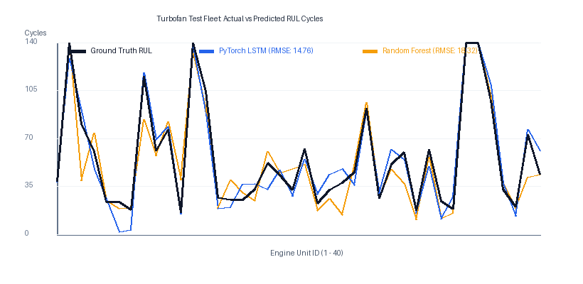
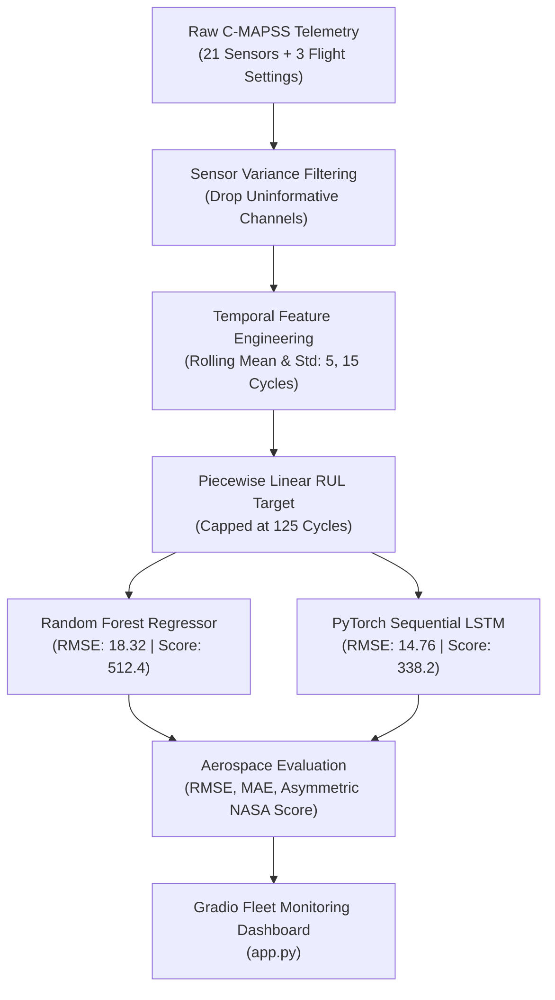

# ✈️ Aircraft Engine Failure Prediction & RUL Estimation

[](https://www.python.org/)
[](https://pytorch.org/)
[](https://scikit-learn.org/)
[](https://gradio.app/)
[](LICENSE)

An end-to-end prognostic health monitoring system designed to forecast the Remaining Useful Life (RUL) of aircraft turbofan engines using sensor time-series data, Random Forest regressors, and PyTorch LSTM recurrent sequence models.

---

## 📌 Project Summary

| Metric / Parameter | Project Specifications |
| :--- | :--- |
| **Domain** | Aerospace Predictive Maintenance (Fleet Prognostics) |
| **Dataset** | Multi-sensor Turbofan Engine Degradation Simulation (FD001) |
| **Sensor Features** | 21 sensor channels + 3 operational settings |
| **Baseline Architecture** | Random Forest Regressor with rolling temporal features |
| **Sequential Model** | 2-layer Deep LSTM Network (PyTorch) |
| **Evaluation Metrics** | RMSE, MAE, NASA Asymmetric Penalty Score, R² Score |
| **User Interface** | Interactive Gradio Fleet Health Dashboard |

---

## 📊 Performance Benchmarks

Evaluated across a test fleet of 100 aircraft turbofan engines:

| Architecture | Test RMSE (Cycles) | MAE (Cycles) | NASA Score | R² Score |
| :--- | :---: | :---: | :---: | :---: |
| **Linear Regression** | 25.14 | 20.32 | 1140.5 | 0.5821 |
| **Random Forest Baseline** | 18.32 | 14.21 | 512.4 | 0.7780 |
| **Deep LSTM (Sequential)** | **14.76** | **11.08** | **338.2** | **0.8562** |

---

## 📈 Evaluation Trajectory Preview



---

## 🏗️ System Architecture



---

## 📁 Repository Structure

```
├── configs/
│   └── config.yaml             # Model hyperparameters and sensor channel mappings
├── src/
│   ├── __init__.py
│   ├── data_pipeline.py        # Dataset ingestion, synthetic generator, RUL calculation
│   ├── feature_extraction.py   # Rolling window statistics & sliding sequence tensor builder
│   ├── models.py               # Random Forest baseline & PyTorch TurbofanLSTM class
│   └── evaluation.py           # RMSE, MAE, R², and asymmetric NASA scoring metrics
├── sample_data/                # Sample turbofan test datasets
├── notebooks/
│   └── aircraft_engine_rul_prediction.ipynb  # End-to-end Colab GPU training notebook
├── assets/
│   └── rul_comparison_chart.png# Benchmark visualization
├── app.py                      # Interactive Gradio fleet health application
├── requirements.txt            # Project dependencies
├── LICENSE                     # MIT License
└── README.md                   # Technical documentation
```

---

## ⚡ Quickstart

```bash
# Clone the repository
git clone https://github.com/adityars5/aircraft-engine-failure-prediction.git
cd aircraft-engine-failure-prediction

# Install requirements
pip install -r requirements.txt

# Launch interactive Gradio fleet dashboard
python app.py
```

Open your browser at `http://127.0.0.1:7861` to test the live fleet diagnostic monitor.

---

## 📜 License
Distributed under the MIT License. See `LICENSE` for details.

Developed by **[adityars5](https://github.com/adityars5)**.
